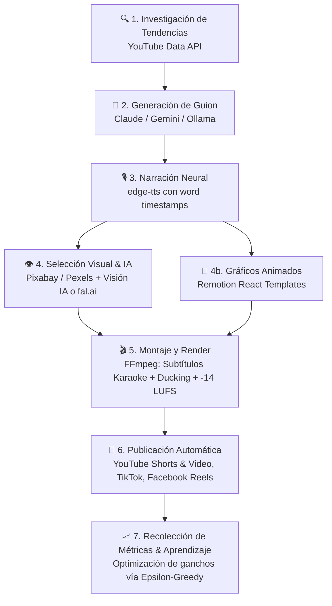

# 🎬 Agente de Clips

> **Sistema autónomo de investigación, generación audiovisual y publicación multicanal impulsado por Inteligencia Artificial.**

[](https://www.python.org/)
[](https://www.remotion.dev/)
[](https://fastapi.tiangolo.com/)
[](https://ffmpeg.org/)
[](https://microsoft.com/windows)

---

## 📌 Descripción General

**Agente de Clips** es una solución integral y desatendida que automatiza el ciclo de vida completo de producción de contenidos en video:

1. **Investiga** las tendencias actuales y métricas de desempeño de cualquier nicho.
2. **Redacta** guiones estructurados para un **video largo horizontal (16:9)** y múltiples **Shorts/Reels verticales (9:16)**.
3. **Sintetiza** narraciones de calidad de estudio con voces neurales y tiempos por palabra.
4. **Selecciona** material visual de alta calidad mediante **visión artificial** (analizando miniaturas y contenido con IA).
5. **Genera** gráficos animados en **Remotion** sincronizados al milisegundo con la voz.
6. **Masteriza** el producto final con subtítulos estilo karaoke, música de fondo dinámica con *ducking* y normalización EBU R128 (-14 LUFS).
7. **Publica** automáticamente en **YouTube, TikTok y Facebook**.
8. **Aprende** de las métricas de engagement mediante algoritmos de aprendizaje por refuerzo para optimizar futuros videos.

Todo gestionado desde una **interfaz web local reactiva** y controlado por un ejecutable ligero integrado en la bandeja del sistema de Windows.

---

## ⚡ Flujo de Trabajo (Pipeline)



---

## 🌟 Características Principales

### 🧠 Inteligencia Artificial Flexible
- **Modelos de Lenguaje:** Compatible con **Google Gemini** (cuenta gratuita sin tarjeta), **Anthropic Claude** o modelos locales offline con **Ollama** (`qwen2.5:7b`, `llama3`, etc.).
- **Curación Visual con Visión:** Un agente visual inspecciona los fotogramas candidatos de stock y selecciona los que mejor representan la escena narrada, descartando material con marcas de agua o baja resolución.
- **Continuidad de Video con IA (Opcional):** Integración con **fal.ai** mediante técnicas *Image-to-Video* encadenadas fotograma a fotograma para máxima coherencia visual.

### 🎨 Gráficos en Movimiento con Remotion
Cinco plantillas modulares programadas en React que se superponen como capas transparentes sobre las tomas:
- **`Titulo`:** Gancho dinámico inicial con palabras rebotantes y resaltado de impacto.
- **`Lista`:** Puntos clave enumerados que aparecen escalonadamente al ser pronunciados.
- **`Dato`:** Contadores numéricos interactivos y anillos de porcentaje progresivos.
- **`Frase`:** Tarjetas minimalistas para citas o reflexiones memorables.
- **`Cta`:** Llamado a la acción final con botón animado.

### 🎧 Audio y Masterización Profesional
- Subtítulos generados con estilo karaoke quemados en el video.
- Música de fondo con mezcla inteligente (*audio ducking*): la música baja de volumen automáticamente cuando hay voz.
- Normalización acústica estandarizada a **-14 LUFS**.

### 📊 Aprendizaje Continuo (Multi-Armed Bandit)
El agente clasifica los guiones según su gancho (*Pregunta, Dato Sorprendente, Error Común, Historia, Promesa, Contraintuitivo*). Transcurridas 48 horas de publicación, analiza vistas e interacciones mediante:
$$\text{Recompensa} = \log(\text{Vistas}) \times (1 + 5 \times \text{Engagement})$$
Optimizando la probabilidad de selección de los estilos con mayor retención mediante una estrategia *$\epsilon$-greedy*.

### 🔒 Seguridad de Credenciales
Ninguna clave secreta o token se almacena en archivos de texto plano o en el repositorio Git. Toda la configuración confidencial se resguarda en el **Administrador de Credenciales de Windows** (Windows Credential Manager / DPAPI).

---

## 🖥️ Interfaz y Experiencia de Usuario

- **Lanzador de un solo clic (`AgenteDeClips.exe`):**
  - Configura el entorno e instala dependencias automáticamente.
  - Se minimiza en el área de notificaciones (System Tray) sin consolas molestas.
  - Menú contextual para abrir la interfaz, ver logs, configurar inicio con Windows o crear accesos directos.
- **Panel Web Local (`http://localhost:8585`):**
  - Monitor en vivo con progreso paso a paso de cada run.
  - Reproductor integrado para previsualizar los videos antes o después de publicar.
  - Panel de configuración con botones de prueba para cada API.
  - Conexión OAuth simplificada para YouTube, TikTok y Facebook.

---

## 🚀 Requisitos del Sistema

- **Sistema Operativo:** Windows 10 o Windows 11 (64-bit).
- **Python:** 3.11 o superior en el `PATH` del sistema.
- **Node.js LTS:** (Opcional, recomendado) Requerido únicamente para renderizar las capas animadas de Remotion.
- **Hardware:** No requiere tarjeta gráfica dedicada (GPU). Las dependencias de `ffmpeg` vienen integradas de manera autónoma.

---

## 📦 Instalación y Puesta en Marcha

### Método 1: Lanzador Rápido (Recomendado)
Simplemente haz doble clic sobre el archivo:
```text
AgenteDeClips.exe
```
El instalador verificará los requisitos, creará el entorno virtual (`venv`), descargará las librerías necesarias y abrirá el navegador en `http://localhost:8585`.

### Método 2: Vía PowerShell
Si prefieres inicializarlo desde la terminal:

```powershell
# 1. Habilitar ejecución de scripts locales
Set-ExecutionPolicy -Scope Process -ExecutionPolicy Bypass

# 2. Ejecutar instalador
.\setup.ps1

# 3. Iniciar el servidor web
.\run_ui.ps1
```

---

## ⚙️ Configuración de Servicios y APIs

Desde el panel **Configuración** de la interfaz web, puedes configurar y validar tus credenciales:

| Proveedor / Servicio | Propósito | Costo |
|---|---|---|
| **Google Gemini API** | Redacción de guiones y análisis de clips | Gratuito (sin tarjeta requerida) |
| **Anthropic Claude API** | Alternativa para generación de guiones | Pago por uso (centavos por run) |
| **Ollama (Local)** | Guiones 100% offline y privados | Gratuito / Código abierto |
| **Pixabay API** | Biblioteca principal de videos de stock | Gratuito (100 req/min) |
| **Pexels API** | Proveedor secundario de clips de stock | Gratuito |
| **YouTube Data API & OAuth** | Detección de tendencias y subida de videos | Gratuito (Google Cloud) |
| **TikTok Developer App** | Publicación en cuenta de TikTok | Gratuito |
| **Facebook Graph API** | Publicación en Páginas y Reels | Gratuito |
| **fal.ai API** | Generación de video con IA (opcional) | Pago por segundo generado |

---

## 🛠️ Ejecución y Automatización

### Ejecución Manual
Ingresa a la pestaña **En vivo** del panel web y presiona **Iniciar run**. Podrás seguir en tiempo real la descarga de recursos, el guion generado y la renderización de cada escena.

### Automatización Diaria
En **Configuración → Ejecución diaria**, habilita la tarea programada para que Windows ejecute el agente a la hora que elijas mediante el Programador de Tareas.

### Interfaz de Línea de Comandos (CLI)
Para flujos avanzados o servidores sin interfaz:

```powershell
# Ejecutar un run completo sin publicar
venv\Scripts\python.exe -m agente.pipeline --no-publish

# Publicar un run generado previamente
venv\Scripts\python.exe -m agente.pipeline --publish-only <ID_DEL_RUN>

# Ejecutar únicamente la actualización de métricas y aprendizaje
venv\Scripts\python.exe -m agente.pipeline --metrics-only
```

---

## 📂 Estructura del Repositorio

```text
Agente-Clip/
├── AgenteDeClips.exe       # Lanzador compilado para Windows
├── launcher/               # Código fuente C# del lanzador y scripts de compilación
├── run_ui.ps1              # Script de arranque del servidor web en consola
├── run_day.ps1             # Script para ejecución programada en segundo plano
├── setup.ps1               # Instalador de entorno y dependencias
├── requirements.txt        # Dependencias de Python
├── DOCUMENTACION_PROYECTO.md # Manual técnico detallado
│
├── agente/                 # Núcleo del pipeline
│   ├── pipeline.py         # Orquestador del flujo y CLI
│   ├── settings.py         # Gestión segura de credenciales (Keyring)
│   ├── events.py           # Sistema de eventos en tiempo real (SSE)
│   ├── research.py         # Análisis de tendencias en YouTube
│   ├── scriptgen.py        # Generador de guiones multi-modelo
│   ├── gemini.py           # Integración con Google Gemini
│   ├── vision.py           # Inspección de clips mediante Computer Vision
│   ├── tts.py              # Síntesis de voz con tiempos de palabras
│   ├── visuals.py          # Búsqueda y descarga de recursos visuales
│   ├── render.py           # Composición y renderizado con FFmpeg
│   ├── motion.py           # Conector entre Python y Remotion
│   ├── learning.py         # Algoritmo de optimización de ganchos
│   ├── metrics.py          # Recolección de métricas de plataformas
│   └── publish/            # Conectores para YouTube, TikTok y Facebook
│
├── motion/                 # Animaciones con Remotion (React + TypeScript)
│   ├── src/templates/      # Plantillas de gráficos animados
│   └── render.mjs          # Script Node.js de renderizado transparente
│
├── app/                    # Interfaz web local (FastAPI + Vanilla JS)
│   ├── server.py           # Servidor API REST y websockets
│   └── static/             # Frontend reactivo (HTML5/CSS3/ES6)
│
└── assets/                 # Recursos locales (música libre de derechos, fuentes)
```

---

## 📄 Licencia

Este proyecto se distribuye bajo la licencia **MIT**. Consulta el archivo `LICENSE` para más información.

Las animaciones generadas con **Remotion** están sujetas a los términos de la [Licencia de Remotion](https://www.remotion.dev/license) (gratuita para individuos y pequeñas entidades).
